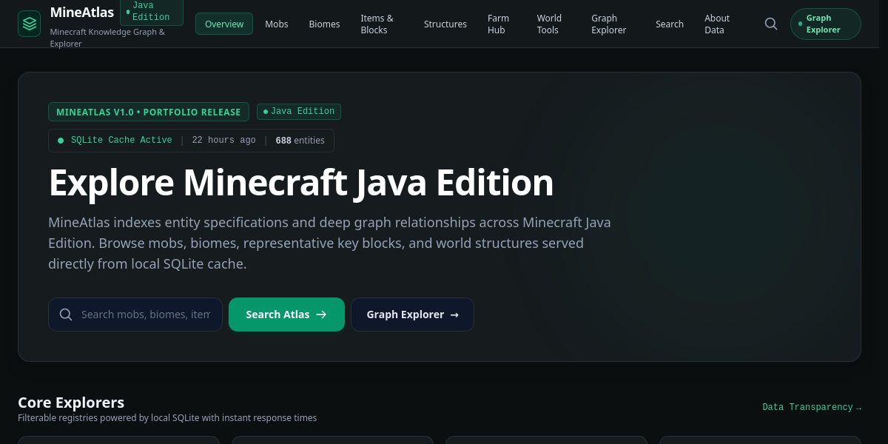
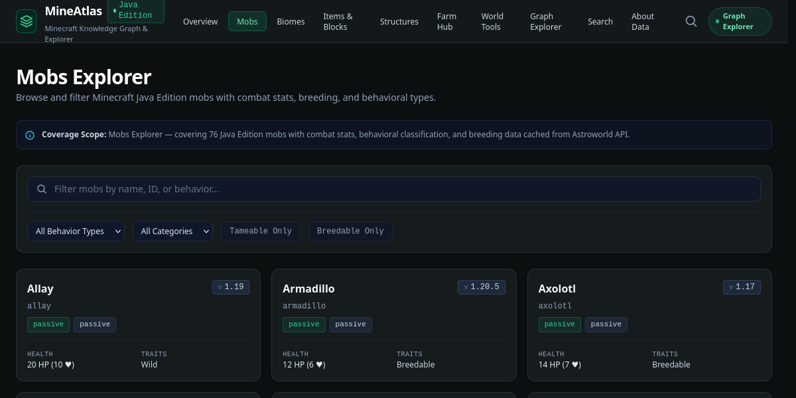
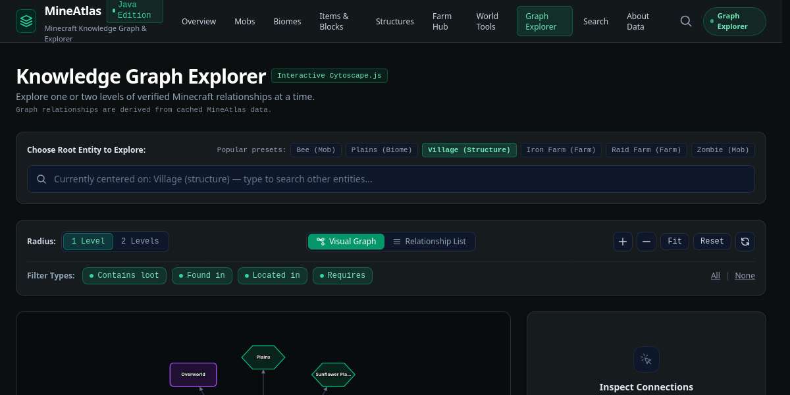
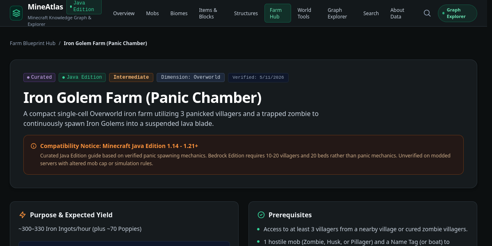
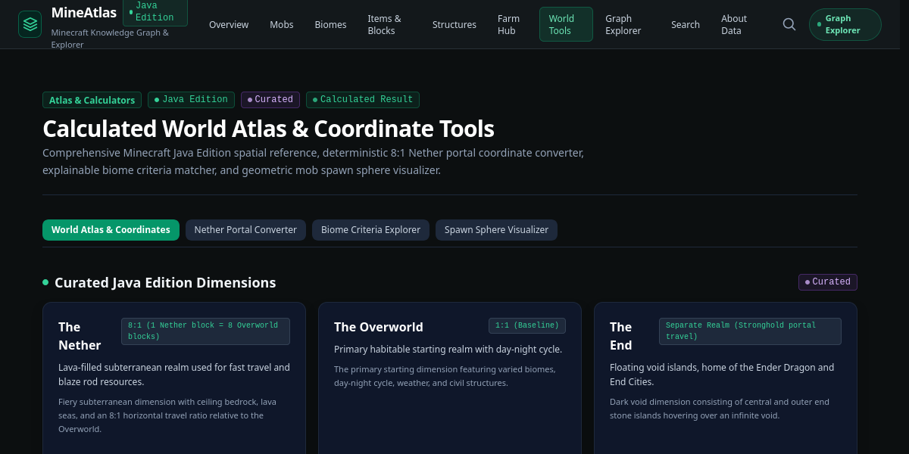

# MineAtlas

**Minecraft Java Edition Atlas & Knowledge Graph Explorer**

[](https://github.com/anikethpowar/MineAtlas-Minecraft-knowledge-and-explorer/actions/workflows/ci.yml)
[](LICENSE)
[](https://www.python.org/)
[](https://react.dev/)
[](https://fastapi.tiangolo.com/)
[](https://www.sqlite.org/)

---

## 1. Overview

**MineAtlas** is a local-first web application and knowledge graph explorer for **Minecraft Java Edition**. 

Rather than serving as a passive data dump, MineAtlas models and reveals the interconnected nature of the Minecraft world. It allows players, technical builders, and survival enthusiasts to navigate semantic connections between mobs, drops, biomes, structures, villager trades, and technical farm designs:

- $\text{Zombie} \xrightarrow{\text{DROPS}} \text{Rotten Flesh}$
- $\text{Enderman} \xrightarrow{\text{SPAWNS\_IN}} \text{The End}$
- $\text{Village} \xrightarrow{\text{FOUND\_IN}} \text{Plains}$
- $\text{Iron Golem Farm} \xrightarrow{\text{REQUIRES}} \text{Villager Panic Mechanics}$
- $\text{Bad Omen Raid Farm} \xrightarrow{\text{PRODUCES}} \text{Totem of Undying}$

All user requests are served synchronously from an indexed local **SQLite cache**, providing instantaneous browsing with zero load placed on upstream servers.

---

## 2. Feature Highlights

- **Core Registries & Explorers:** Comprehensive, filterable registries for 76 mobs (with combat stats and breeding items), 64 biomes (with temperatures and climate categories), 100 representative key items and functional blocks, and 24 world structures.
- **Interactive Knowledge Graph (`/graph`):** Cytoscape.js visual graph canvas supporting localized depth-1 and depth-2 neighborhood traversals, predicate filtering, deterministic "Why connected?" explanations, and an accessible Relationship List table.
- **Curated Farm Blueprint Hub (`/farms`):** Handcrafted guides for technical Java Edition architectures (Iron Golem Panic Chamber, Bad Omen Raid Farm, Automatic Villager Breeder) with version-specific compatibility notes (such as Java 1.21 Ominous Bottle changes), interactive material checklists, and original spatial zone schematics.
- **Calculated World Atlas Tools (`/world`):** Deterministic 8:1 Nether portal horizontal coordinate converter, rule-based climate/rarity biome criteria explorer, and geometric mob spawn/despawn radius visualizer with responsive SVG diagrams.
- **Local-First & Safe Caching:** Three-tier architecture where the React frontend only communicates with the FastAPI backend. Upstream API calls are throttled by an internal 50 req/min token bucket rate limiter and cached permanently in SQLite.
- **Transparent Provenance Tracking:** Every entity, relation, and formula displays a clear provenance badge: `API Cached` (upstream synced), `Curated Reference` (human-verified technical design), or `Calculated Result` (derived mathematics).

---

## 3. Application Screenshots

The following screenshots capture the real application running locally on desktop resolution:

### Home Overview & Quick Navigation

*Hero section with quick search, data freshness telemetry, and direct links into core explorers.*

---

### Mobs Explorer Registry

*Filterable Minecraft Java Edition mob registry displaying combat stats, behavioral traits, and breeding requirements.*

---

### Cytoscape.js Knowledge Graph Explorer

*Interactive graph explorer showing concentric node layouts, relationship edges, and localized depth-1/depth-2 radius controls.*

---

### Curated Farm Blueprint Guide

*Curated technical guide for an Iron Golem Farm with Java 1.14–1.21+ compatibility notices and yield specifications.*

---

### Calculated World Atlas Tools

*Spatial reference, Nether portal 8:1 scaling calculator, biome criteria builder, and mob spawn sphere visualizer.*

---

## 4. System Architecture

MineAtlas enforces strict separation between user browsing and external API interactions:

```mermaid
flowchart TD
    subgraph Tier 1: Presentation Layer
        UI["React 18 + TypeScript + Vite (:5173)\nTailwind CSS • Cytoscape.js • SVG Schematics"]
    end

    subgraph Tier 2: Application & Local Cache
        API["FastAPI Backend (:8000)\nPydantic Schemas • CORS • Local Query Engine"]
        DB[("SQLite Database (mineatlas.db)\nSQLAlchemy 2.0 • 16 Tables • Alembic")]
        API <-->|Synchronous SQL Reads| DB
    end

    subgraph Tier 3: Controlled Upstream Ingestion
        CLI["Background CLI Sync & Seeders\nToken-Bucket Limiter (≤ 50 req/min)"]
        AW["Astroworld Public API\n(api.astroworldmc.com)"]
        CLI <-->|Throttled HTTPS Ingestion| AW
        CLI -->|Idempotent Upsert & Edge Derivation| DB
    end

    UI <-->|HTTP REST /api/* (Zero External Calls)| API

    classDef presentation fill:#0f172a,stroke:#38bdf8,stroke-width:2px,color:#f8fafc;
    classDef application fill:#022c22,stroke:#10b981,stroke-width:2px,color:#f8fafc;
    classDef upstream fill:#1e1b4b,stroke:#818cf8,stroke-width:2px,color:#f8fafc;

    class UI presentation;
    class API,DB application;
    class CLI,AW upstream;
```

> [!IMPORTANT]
> **Zero Browser Leaks:** Normal user navigation and searches never make outbound network connections to Astroworld or third-party APIs. All queries are served locally from SQLite.

---

## 5. Technology Stack

| Layer | Technology | Purpose |
| :--- | :--- | :--- |
| **Frontend Framework** | React 18 + TypeScript | Component-driven UI with strict static types |
| **Build & Tooling** | Vite | Lightning-fast HMR and optimized Rollup production builds |
| **Styling** | Tailwind CSS | Responsive dark exploration theme inspired by Minecraft tools |
| **Graph Visualization** | Cytoscape.js | High-performance canvas for directed knowledge graph rendering |
| **Backend Framework** | Python 3.12 + FastAPI | Asynchronous REST API with Pydantic request/response validation |
| **Database** | SQLite | Single-file zero-config relational database (`mineatlas.db`) |
| **ORM & Migrations** | SQLAlchemy 2.0 + Alembic | Declarative database models and versioned schema migrations |
| **HTTP Client** | `httpx` | Resilient upstream client with token bucket rate limiting |
| **Backend Testing** | Pytest (85 tests) | Unit and integration test suite covering APIs, schemas, and math |
| **Frontend Testing** | Vitest + Testing Library (48 tests) | Component, routing, graph transformation, and visual tests |

---

## 6. Key Application Routes

| Route | Description | Provenance Type |
| :--- | :--- | :---: |
| `/` | System overview, hero search, and cache telemetry | Mixed |
| `/mobs` | Searchable mob registry with health, damage, and breeding filters | `astroworld_api` |
| `/mobs/:mobId` | Deep specification for a mob with direct links to the graph | `astroworld_api` |
| `/biomes` | Climate and dimension biome explorer with precipitation filters | `astroworld_api` |
| `/items` | Representative catalog of 100 key functional items and blocks | `astroworld_api` |
| `/structures` | World-generated structures with Y-level ranges | `astroworld_api` |
| `/graph` | Interactive Cytoscape.js Knowledge Graph Explorer | `calculated` |
| `/farms` | Farm Blueprint Hub listing verified Java Edition designs | `curated` |
| `/farms/:farmSlug` | Step-by-step farm guide with material checklist and schematic | `curated` |
| `/world` | Dimension reference, 8:1 portal converter, and spawn sphere visualizer | `calculated` / `curated` |
| `/about-data` | Data transparency, rate limits, attribution, and disclaimers | — |

---

## 7. Quick Start on Linux Mint

Follow these exact steps from the project root directory (`~/Desktop/mineatlas`). No Docker or external database servers are needed:

### Prerequisites
- Python 3.12+
- Node.js 20+ (Node 22 recommended)
- Git

### 1. Setup Backend & Seed Database
```bash
# 1. Navigate to repository root
cd ~/Desktop/mineatlas

# 2. Activate Python virtual environment
source venv/bin/activate

# 3. Install backend dependencies
pip install -r backend/requirements.txt

# 4. Apply database schema migrations
cd backend
alembic upgrade head
cd ..

# 5. Populate curated farm blueprints and world reference data
PYTHONPATH=backend python -m app.scripts.seed_curated_farms
PYTHONPATH=backend python -m app.scripts.seed_world_reference

# 6. (Optional) Run initial Astroworld API sync if cache is empty
# Note: mineatlas.db is pre-synced with 688 entities and 650 edges
# PYTHONPATH=backend python -m app.scripts.sync_astroworld
```

### 2. Start the Backend API Server
```bash
# Start FastAPI backend at http://localhost:8000
PYTHONPATH=backend uvicorn app.main:app --app-dir backend --reload --host 127.0.0.1 --port 8000
```
- Interactive API Docs (Swagger): [http://localhost:8000/docs](http://localhost:8000/docs)
- Health Check: [http://localhost:8000/api/health](http://localhost:8000/api/health)
- Cache Telemetry: [http://localhost:8000/api/data-status](http://localhost:8000/api/data-status)

### 3. Setup & Start the Frontend (Second Terminal)
```bash
# 1. Open a new terminal and navigate to frontend directory
cd ~/Desktop/mineatlas/frontend

# 2. Install dependencies via npm ci
npm ci

# 3. Start Vite local development server
npm run dev
```
- Open your browser to: **[http://localhost:5173](http://localhost:5173)**

---

## 8. Automated Testing & Verification

Run the automated test suites locally:

```bash
# 1. Run all backend tests (85 passing tests)
source venv/bin/activate
PYTHONPATH=backend pytest backend/tests -v

# 2. Run all frontend tests in non-watch mode (48 passing tests)
npm test --prefix frontend

# 3. Run production build verification (TypeScript typecheck + Vite bundle)
npm run build --prefix frontend
```

---

## 9. Data Provenance & Ingestion Architecture

MineAtlas distinguishes three data categories:

1. **API-Backed Data (`source_type = "astroworld_api"`):**
   - Ingested from the public Astroworld API through the offline CLI script `sync_astroworld.py`.
   - Gated by an internal **50 requests per minute** token bucket limiter (1 request every 1.2s with exponential backoff).
   - Upserted idempotently into local SQLite tables to avoid duplicate entries.
2. **Curated Content (`source_type = "curated"`):**
   - Handcrafted technical farm blueprints and canonical dimension specifications authored specifically for Minecraft Java Edition.
   - Includes version compatibility notes, material checklists, and simplified spatial zone schematics.
3. **Calculated Results (`source_type = "calculated"`):**
   - Derived graph relationships (e.g., `ZOMBIE -> DROPS -> ROTTEN_FLESH`), 8:1 Nether portal coordinate conversions, spawn sphere geometry, and deterministic biome criteria matching.

---

## 10. Upstream Attribution

Entity data in MineAtlas is powered by the Astroworld API under proper attribution:

<p align="center">
  <a href="https://api.astroworldmc.com" target="_blank" rel="noopener">
    <strong>Powered by Astroworld API</strong>
  </a>
</p>

An equivalent visible and accessible link is provided inside the running application on the [`/about-data`](http://localhost:5173/about-data) page.

---

## 11. Honest Limitations

- **Not Complete Block Coverage:** MineAtlas indexes a curated selection of 100 key functional items and blocks from Astroworld. It does not claim complete coverage of all 1,000+ decorative Minecraft block variants.
- **No Arbitrary Seed Analysis:** MineAtlas does **not** locate biomes, structures, or slime chunks for an arbitrary user-submitted Minecraft seed.
- **Coordinate Target Only:** The Nether Portal converter calculates the mathematical 8:1 target coordinates. It does not simulate in-game 128-block portal search radius linking or obstructions.
- **Geometric Planning Model:** The spawn sphere visualizer computes Euclidean 3D sphere geometry. It is not an in-game mob spawning simulation engine and does not simulate mob caps or light-level tick passes.
- **Version Sensitivity:** Technical farm designs rely on Java Edition mechanics that can shift between major releases (such as the introduction of Ominous Bottles in Java 1.21). Always review guide notices before building in survival.
- **No User Accounts:** MineAtlas is a local-first exploration tool; it does not include user accounts, authentication, or cloud data sync.
- **Non-Affiliation:** Not an official Minecraft product. Not approved by or associated with Mojang or Microsoft.

---

## 12. Future Roadmap

- [ ] **Advancements & Lore Guide:** Visual advancement tree progression tracking and achievement prerequisites.
- [ ] **Expanded Farm Blueprints:** Additional curated technical guides (Wither Skeleton Farm, Enderman Farm, Creeper Powder Farm).
- [ ] **Expanded Items Catalog:** Integration with additional open-source Java Edition block registries to expand past the initial 100 key blocks.
- [ ] **Interactive Portal Alignment Planner:** Visual 2D coordinate map showing mutual portal linkage zones.
- [ ] **Containerized Local Deployment Option:** Optional single-command compose file for persistent containerized desktop environments.

---

## 13. License

MineAtlas is distributed under the terms of the **MIT License**. See [`LICENSE`](LICENSE) for full details.
