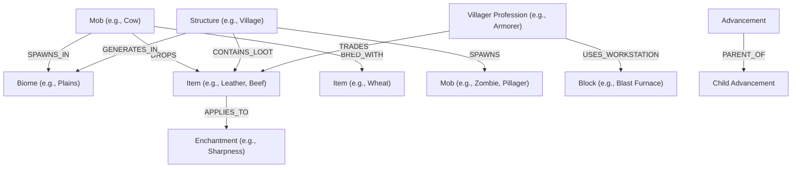

# Astroworld API Data Audit (Phase 2 Findings)

This document records the empirical findings from auditing the upstream [Astroworld API](https://api.astroworldmc.com). The purpose of this audit is to understand real upstream data structures, observed field types, coverage characteristics, and relationship opportunities before designing the SQLite database schema in Phase 3.

---

## 1. Audit Overview & Execution Details

- **Upstream Base URL:** `https://api.astroworldmc.com`
- **Audit Execution Date:** 2026-11-04 (UTC)
- **Snapshot Directory:** `backend/data/raw_snapshots/2026-11-04T12-37-00Z/`
- **Execution Mode:** Sequential with a 1.3-second delay between calls
- **Total Endpoints Tested:** 9
- **Successful Endpoints:** 9 (100% success rate)
- **Failed Endpoints:** 0
- **Rate Limit Encounters:** None (9 requests consumed out of the 50 req/min internal budget)

---

## 2. Collection Endpoints Summary

All endpoints returned HTTP 200 with standard top-level JSON fields:
`["count", "data", "success"]`

| Endpoint | Resource | Record Count | Sample Filename | Status |
| :--- | :--- | :---: | :--- | :---: |
| `GET /api/v1/mobs` | Mobs | **76** | `mobs.json` | OK |
| `GET /api/v1/biomes` | Biomes | **64** | `biomes.json` | OK |
| `GET /api/v1/items` | Items & Key Blocks | **100** | `items.json` | OK |
| `GET /api/v1/enchantments` | Enchantments | **40** | `enchantments.json` | OK |
| `GET /api/v1/structures` | Structures | **24** | `structures.json` | OK |
| `GET /api/v1/commands` | Commands | **57** | `commands.json` | OK |
| `GET /api/v1/versions` | Version History | **36** | `versions.json` | OK |
| `GET /api/v1/achievements` | Advancements | **111** | `achievements.json` | OK |
| `GET /api/v1/trades` | Villager Professions | **13** | `trades.json` | OK |

---

## 3. Resource Field Breakdown & Structure Observations

### 3.1 Mobs (`/api/v1/mobs` - 76 records)
- **Primary Identifier:** `id` (e.g., `"cow"`, `"zombie"`, `"creeper"`)
- **Observed Fields (18):**
  - `id`: string (slug)
  - `name`: string (display name, e.g., `"Cow"`)
  - `type`: string (`"passive"`, `"hostile"`, `"neutral"`, `"boss"`)
  - `category`: string (e.g., `"animal"`, `"undead"`, `"arthropod"`)
  - `behavior`: string (behavior description)
  - `hp`: integer / float (health points)
  - `damage`: object (`{"easy": int, "normal": int, "hard": int}`)
  - `xpDrop`: object (`{"min": int, "max": int}`)
  - `spawnBiomes`: list of strings (e.g., `["Plains", "Forest", "Sunflower Plains"]`)
  - `spawnConditions`: string (text describing light level, block type, group size)
  - `drops`: list of objects / strings (items dropped upon death)
  - `tameable`: boolean
  - `tamingMethod`: string | null (observed null for untameable mobs)
  - `breedable`: boolean
  - `breedingItem`: list of strings | null (observed null for non-breedable mobs)
  - `weaknesses`: list of strings
  - `versionAdded`: string (e.g., `"Alpha"`, `"1.0"`)
  - `notes`: string
- **Sampling Notes:**
  - `breedingItem` and `tamingMethod` are reliably `null` when `breedable: false` or `tameable: false`.
  - `damage` is an object specifying difficulty tiers (`easy`, `normal`, `hard`), with `0` for passive mobs.

### 3.2 Biomes (`/api/v1/biomes` - 64 records)
- **Primary Identifier:** `id` (e.g., `"minecraft:plains"`, `"minecraft:desert"`)
- **Observed Fields (14):**
  - `id`: namespaced identifier string (`minecraft:...`)
  - `name`: string (e.g., `"Plains"`)
  - `dimension`: string (`"overworld"`, `"nether"`, `"the_end"`)
  - `category`: string (`"temperate"`, `"arid"`, `"cold"`, `"aquatic"`, `"caves"`)
  - `temperature`: float (e.g., `0.8`, `2.0`, `-0.5`)
  - `precipitation`: string (`"rain"`, `"snow"`, `"none"`)
  - `rarity`: string (`"common"`, `"uncommon"`, `"rare"`)
  - `terrainFeatures`: list of strings (e.g., `["flat terrain", "tall grass"]`)
  - `uniqueBlocks`: list of strings (blocks characteristic of the biome)
  - `spawningMobs`: list of strings (names of mobs spawning here)
  - `structuresFound`: list of strings (structures generating in this biome)
  - `colors`: object (grass, sky, water, foliage color hex values)
  - `versionAdded`: string
  - `notes`: string
- **Sampling Notes:**
  - Direct two-way linkage exists between `biomes.spawningMobs` and `mobs.spawnBiomes`, as well as `biomes.structuresFound` and `structures.biomes`.

### 3.3 Items & Key Blocks (`/api/v1/items` - 100 records)
- **Primary Identifier:** `id` (e.g., `"wooden_pickaxe"`, `"diamond"`, `"iron_ingot"`)
- **Observed Fields (14):**
  - `id`: string slug
  - `name`: string display name
  - `category`: string (`"tool"`, `"combat"`, `"resource"`, `"food"`, `"brewing"`, `"redstone"`, etc.)
  - `stackSize`: integer (64, 16, or 1)
  - `durability`: integer | null (null for non-durability items like ingots, diamonds)
  - `description`: string
  - `obtainedBy`: list of strings (`["Crafting"]`, `["Mining"]`, `["Mob Drop"]`, `["Smelting"]`)
  - `craftingRecipe`: object | null (contains `pattern` matrix and `ingredients` map; null if not craftable)
  - `applicableEnchantments`: list of strings
  - `enchantable`: boolean
  - `foodValue`: object | null (`{"hunger": int, "saturation": float}`; null for non-food)
  - `fuelValue`: integer | null (smelting time in ticks; null for non-fuels)
  - `versionAdded`: string
  - `notes`: string
- **Sampling Notes:**
  - Confirms our project scope: Astroworld provides a curated set of **100 key items and blocks**, not every cosmetic block variant.
  - Contextual fields (`craftingRecipe`, `durability`, `foodValue`, `fuelValue`) are cleanly populated when applicable and `null` otherwise.

### 3.4 Enchantments (`/api/v1/enchantments` - 40 records)
- **Primary Identifier:** `id` (e.g., `"sharpness"`, `"mending"`, `"unbreaking"`)
- **Observed Fields (14):**
  - `id`: string slug
  - `name`: string display name
  - `category`: string (`"weapons"`, `"armor"`, `"tools"`, `"bow"`, `"trident"`, `"fishing"`)
  - `maxLevel`: integer (e.g., 5, 3, 1)
  - `description`: string
  - `effectPerLevel`: list of strings detailing bonus damage/protection per level
  - `applicableItems`: list of strings (e.g., `["sword", "axe"]`)
  - `incompatibleWith`: list of strings (e.g., Sharpness incompatible with Smite, Bane of Arthropods)
  - `obtainedFrom`: list of strings (`["Enchanting Table", "Anvil", "Loot Chest", "Villager Trading"]`)
  - `treasureOnly`: boolean (true for Mending, Frost Walker, Soul Speed, Swift Sneak)
  - `curseOf`: boolean (true for Curse of Binding, Curse of Vanishing)
  - `weight`: integer / string (enchantment table selection weight)
  - `versionAdded`: string
  - `notes`: string

### 3.5 Structures (`/api/v1/structures` - 24 records)
- **Primary Identifier:** `id` (e.g., `"village"`, `"monument"`, `"ancient_city"`, `"fortress"`)
- **Observed Fields (16):**
  - `id`: string slug
  - `name`: string display name
  - `dimension`: string (`"overworld"`, `"nether"`, `"the_end"`)
  - `category`: string (`"settlement"`, `"dungeon"`, `"ruin"`, `"temple"`)
  - `rarity`: string (`"common"`, `"uncommon"`, `"rare"`)
  - `yLevel`: object (`{"min": int, "max": int}`)
  - `biomes`: list of strings (biomes where this structure can generate)
  - `features`: list of strings (architectural elements, chests, cages)
  - `hostileMobs`: list of strings (spawners or natural spawns inside)
  - `loot`: list of strings (regular chest loot)
  - `uniqueLoot`: list of strings (exclusive items, armor trims, music discs)
  - `dangers`: list of strings
  - `howToFind`: string (e.g., explorer maps, eye of ender, elevation hints)
  - `rewards`: string / list
  - `versionAdded`: string
  - `notes`: string

### 3.6 Villager Trades (`/api/v1/trades` - 13 records)
- **Primary Identifier:** `id` (e.g., `"armorer"`, `"librarian"`, `"cleric"`, `"fletcher"`)
- **Observed Fields (6):**
  - `id`: string slug (matches 13 vanilla professions)
  - `name`: string display name
  - `workstation`: string (e.g., `"Blast Furnace"`, `"Lectern"`, `"Brewing Stand"`, `"Fletching Table"`)
  - `description`: string summary of what the profession buys and sells
  - `biomeSpecific`: boolean (whether trades vary by villager biome origin)
  - `levels`: list of tier objects (`Novice`, `Apprentice`, `Journeyman`, `Expert`, `Master`), each containing trade arrays with input items (`gives`, `givesAmount`) and output items (`receives`, `receivesAmount`).

### 3.7 Advancements / Achievements (`/api/v1/achievements` - 111 records)
- **Primary Identifier:** `id` (e.g., `"minecraft:story/root"`, `"minecraft:nether/fast_travel"`)
- **Observed Fields (15):**
  - `id`: namespaced identifier string
  - `slug`: short slug
  - `name`: display name
  - `tab`: string (`"minecraft"`, `"nether"`, `"end"`, `"adventure"`, `"husbandry"`)
  - `description`: string
  - `icon`: string
  - `parent`: string | null (ID of parent advancement; null for root nodes)
  - `howToComplete`: string instructions
  - `prerequisites`: list of strings
  - `rewards`: string / list
  - `xpReward`: integer
  - `isGoal`: boolean
  - `isChallenge`: boolean
  - `difficulty`: string
  - `versionAdded`: string

### 3.8 Commands (`/api/v1/commands` - 57 records)
- **Observed Fields (11):** `name`, `syntax`, `description`, `parameters` (array with `name`, `type`, `optional`, `description`), `permissionLevel` (integer 0-4), `versionAdded`, `category`, `examples`, `notes`, `commonMistakes`, `relatedCommands`.

### 3.9 Versions (`/api/v1/versions` - 36 records)
- **Observed Fields (11):** `slug`, `name` (e.g. `"1.21"`, `"1.20"`), `edition` (`"java"`), `releaseDate`, `type`, `updateName` (e.g. `"Tricky Trials"`), `majorFeatures`, `notableChanges`, `notableFixes`, `previousVersion`, `nextVersion`.

---

## 4. Relationship Opportunities for MineAtlas

The audit demonstrates rich, explicit relationship graph potential:

Specific graph edges supported directly by upstream data:
1. **Mob → SPAWNS_IN → Biome**: Derived from `mobs.spawnBiomes` ↔ `biomes.name`.
2. **Mob → DROPS → Item**: Derived from `mobs.drops`.
3. **Mob → BRED_WITH → Item**: Derived from `mobs.breedingItem`.
4. **Structure → GENERATES_IN → Biome**: Derived from `structures.biomes`.
5. **Structure → CONTAINS_LOOT → Item**: Derived from `structures.loot` and `structures.uniqueLoot`.
6. **Structure → SPAWNS → Mob**: Derived from `structures.hostileMobs`.
7. **Item → ENCHANTABLE_WITH → Enchantment**: Derived from `items.applicableEnchantments` and `enchantments.applicableItems`.
8. **Villager Profession → WORKSTATION → Item/Block**: Derived from `trades.workstation`.
9. **Villager Profession → TRADES → Item**: Derived from `trades.levels[].trades[].receives` and `gives`.
10. **Advancement → PARENT_OF → Advancement**: Tree hierarchy derived from `achievements.parent`.

---

## 5. Known Coverage Gaps, Distinctions & Caveats

1. **Items Coverage is Curated (100 items), not Exhaustive:**
   - The upstream API provides 100 core functional items and key blocks.
   - *Status:* **Expected by design**. MineAtlas is scoped as an "Items & Key Blocks Explorer", not an exhaustive index of all 1,000+ minor block variants.
2. **Mob Spawning Light Levels & Spawn Conditions:**
   - `spawnConditions` is provided as human-readable prose (e.g., `"Spawns on grass blocks with light level 9+, in groups of 4."`) rather than normalized integer fields.
   - *Status:* In Phase 3 SQLite schema, this will be stored as descriptive text with optional parsed integer helpers.
3. **Villager Trades Structure:**
   - The 13 trades records represent the 13 villager professions rather than individual trade rows. Trades are nested inside `levels` arrays.
   - *Status:* In Phase 3 SQLite schema, we will normalize this into `villager_professions` and a child table `villager_trades`.
4. **Distinction: "Not Provided by API" vs. "Not Yet Analysed":**
   - *Redstone tick timings / exact farm rates:* **Not provided by Astroworld API**. These will be provided by curated MineAtlas guides in later phases.
   - *Block hardness / tool blast resistance for non-key blocks:* **Not provided by Astroworld API**.
   - *Version history & commands:* Full collection exists in snapshots; **analysed and verified**, low priority for core farm/entity explorer graph.

---

## 6. Phase 3 Implications for SQLite Database Design

Based on these audit results, our Phase 3 SQLite schema should follow these architectural decisions:

1. **Core Relational Tables:**
   - `mobs` (id, name, type, category, hp, behavior, spawn_conditions, xp_min, xp_max, version_added)
   - `biomes` (id, name, dimension, category, temperature, precipitation, rarity, version_added)
   - `items` (id, name, category, stack_size, durability, description, enchantable, version_added)
   - `enchantments` (id, name, category, max_level, description, treasure_only, curse_of, weight, version_added)
   - `structures` (id, name, dimension, category, rarity, y_min, y_max, version_added)
   - `villager_professions` (id, name, workstation, description, biome_specific)
   - `advancements` (id, slug, name, tab, description, icon, parent_id, is_goal, is_challenge, xp_reward)

2. **Junction Tables for Graph Edges:**
   - `mob_biomes (mob_id, biome_id)`
   - `mob_drops (mob_id, item_id, drop_notes)`
   - `mob_breeding_items (mob_id, item_id)`
   - `structure_biomes (structure_id, biome_id)`
   - `structure_mobs (structure_id, mob_id)`
   - `structure_loot (structure_id, item_id, is_unique)`
   - `item_enchantments (item_id, enchantment_id)`
   - `villager_trades (profession_id, level, give_item, give_amount, receive_item, receive_amount)`

3. **Complex Nested Objects:**
   - Objects such as `craftingRecipe` matrix and `colors` object will be stored as JSON text columns (`TEXT`) in SQLite, accessible via SQLite's built-in `json_extract()` when needed.

4. **Zero Cloud Dependencies:**
   - The entire database will reside in a single local file `backend/data/mineatlas.db` on Linux Mint without Docker or external server processes.

