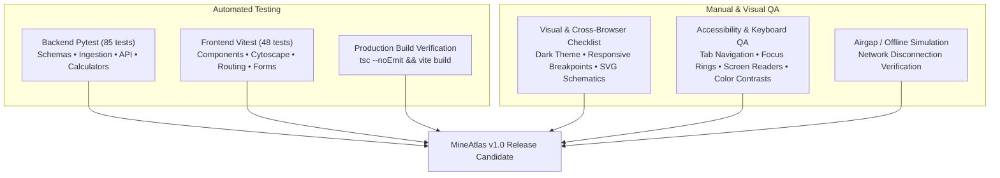

# MineAtlas Quality Assurance & Test Strategy

This document details the test strategy, regression coverage, visual QA procedures, accessibility standards, and offline safety checks for **MineAtlas**.

---

## 1. Quality Assurance Philosophy

MineAtlas adheres to four non-negotiable architectural guarantees:
1. **Zero Browser Leaks:** The React frontend never connects to upstream APIs (Astroworld or external servers).
2. **Deterministic Offline Caching:** Normal user browsing operations query indexed SQLite tables with zero network overhead.
3. **Upstream Rate-Limit Safety:** Background CLI sync tasks are strictly throttled to $\le 50$ requests per minute with exponential backoff.
4. **Java Edition Integrity:** All combat values, drop percentages, portal scaling factors, and farm mechanics apply strictly to **Minecraft Java Edition**.

---

## 2. Test Strategy & Architecture



---

## 3. Backend Test Coverage Areas (Pytest)

The backend test suite consists of **85 automated tests** organized across targeted modules:

| Test Module | Coverage Scope | Key Verifications |
| :--- | :--- | :--- |
| `test_health.py` | Operational health | `/api/health` status, service identity, and CORS headers. |
| `test_status_endpoint.py` | Cache telemetry | `/api/data-status` totals, sync timestamps, and freshness calculations. |
| `test_search.py` | Global multi-entity search | Case-insensitive prefix/infix matching across mobs, biomes, items, and structures. |
| `test_explorer_endpoints.py` | Core explorer REST APIs | Pagination, sorting, category/rarity filters for mobs, biomes, items, and structures. |
| `test_reference_endpoints.py` | Auxiliary registries | Enchantments, advancements, version history, and villager trade tables. |
| `test_graph_endpoints.py` | Graph traversal engine | Depth-1 and depth-2 neighborhood traversals, predicate filtering, and depth validation. |
| `test_farms.py` | Curated farm blueprints | Seeder idempotency, detail guide schema, materials, checklists, and 0 external network calls. |
| `test_world.py` | Calculated world tools | Nether portal 8:1 math, coordinate boundaries, biome criteria matching, and spawn sphere geometry. |
| `test_rate_limiter.py` | Token-bucket limiter | 50 req/min cap enforcement, burst behavior, refill timing, and thread safety. |
| `test_astroworld_client.py` | HTTP client resilience | Upstream timeouts, connection retries, 429 backoff parsing, and error encapsulation. |
| `test_ingestion_service.py` | Ingestion & upsert | Idempotent table upserts, batch commits, and sync run logging. |
| `test_relationship_derivation.py`| Semantic graph derivation | Automated creation of 650 directed edges (`DROPS`, `SPAWNS_IN`, `FOUND_IN`, `TRADES`). |
| `test_normalizers.py` | Data normalization | Drop chance conversion, health point parsing, and Roman numeral version formatting. |
| `test_database_schema.py` | SQLite schema integrity | Foreign key constraints, table indexes, and nullable column definitions. |

---

## 4. Frontend Test Coverage Areas (Vitest)

The frontend test suite consists of **48 automated tests** covering UI components, user interactions, and client-side routing:

| Test Module | Tests | Key Verifications |
| :--- | :---: | :--- |
| `src/test/navigation.test.tsx` | 5 | Header navigation links, mobile drawer toggling, active link highlighting, and branding. |
| `src/test/explorers.test.tsx` | 6 | Search filtering, category dropdowns, pagination controls, and empty state rendering. |
| `src/test/detail.test.tsx` | 2 | Mob combat/drop tables, biome environmental stats, and direct links to the graph explorer. |
| `src/test/search.test.tsx` | 4 | Search input debouncing, multi-category search results, and enter-key submission. |
| `src/test/graphExplorer.test.tsx` | 10 | Cytoscape.js canvas mounting, concentric layout, root entity selection, and depth toggle. |
| `src/test/graphTransformers.test.ts` | 7 | Transform backend graph responses into Cytoscape elements with shape codes and labels. |
| `src/test/farms.test.tsx` | 8 | Farm list cards, guide detail view, interactive material checklist toggles, and SVG schematics. |
| `src/test/world.test.tsx` | 7 | Dimension cards, coordinate explainer SVG, Nether portal converter with clipboard copy, biome criteria matcher, and spawn sphere visualizer. |
| `src/test/aboutData.test.tsx` | 1 | Three-tier architecture rules, visible dofollow Astroworld attribution, and legal disclaimers. |

---

## 5. Manual Visual & User Flow QA Checklist

Perform this manual regression sweep prior to tagging a release:

1. **Home Page Flow (`/`):**
   - [ ] Hero search bar accepts input and navigates to `/search?q=...`.
   - [ ] Core explorer cards display correct entity counts (e.g. 76 mobs, 64 biomes, 100 items).
   - [ ] Data freshness indicator reflects local cache status.
2. **Global Search Flow (`/search`):**
   - [ ] Queries across all 4 entity types simultaneously.
   - [ ] Category filter pills toggle visible results without re-fetching.
3. **Explorer Registries (`/mobs`, `/biomes`, `/items`, `/structures`):**
   - [ ] Multi-parameter filters (e.g., Passive + Breedable) filter client-side / server-side cleanly.
   - [ ] Pagination controls advance and previous pages without visual layout shifts.
   - [ ] Empty state renders when filters match 0 records.
4. **Detail Page & Knowledge Graph Traversal:**
   - [ ] Entity detail view (e.g., `/mobs/zombie`) shows drops and spawn conditions.
   - [ ] Clicking "Explore in Knowledge Graph" opens `/graph?type=mob&id=zombie&depth=1`.
   - [ ] Clicking connected nodes in the graph recenters the visualization on the clicked entity.
   - [ ] Switching to "Relationship List" mode displays an accessible tabular representation.
5. **Curated Farm Blueprint Hub (`/farms` & `/farms/:farmSlug`):**
   - [ ] Farm list displays difficulty badges, dimension tags, and estimated outputs.
   - [ ] Guide detail displays version compatibility warning (e.g. Java 1.21 Ominous Bottle note).
   - [ ] Interactive material checkboxes persist in browser session without errors.
   - [ ] Spatial zone SVG schematic renders clearly with color-coded operational zones.
6. **Calculated World Tools (`/world`):**
   - [ ] Dimension reference cards display altitude limits (-64 to 320 for Overworld) and bed usability.
   - [ ] Coordinate diagram illustrates Cartesian axes, compass bearings, and world border.
   - [ ] Portal converter computes 8:1 scaling in both directions; copy button triggers visual feedback.
   - [ ] Biome criteria explorer applies filters and outputs deterministic match reasons.
   - [ ] Spawn sphere visualizer calculates area, volume, and height range for presets (24, 32, 128).
7. **About Data Page (`/about-data`):**
   - [ ] Displays prominent, visible `<a href="https://api.astroworldmc.com">Powered by Astroworld API</a>` link without `rel="nofollow"`.
   - [ ] Legal disclaimers state: "Not an official Minecraft product. Not approved by or associated with Mojang or Microsoft."

---

## 6. Accessibility (A11y) QA Checklist

- **Keyboard Navigation:** Every interactive button, input, tab, and card link can be reached using `Tab` and triggered using `Enter` or `Space`.
- **Visible Focus Indicators:** Tailwind `focus:ring-2 focus:ring-emerald-500` ensures clear visual outlines on all inputs and buttons.
- **Form Association:** Every `<input>` and `<select>` is explicitly connected to a `<label>` via `htmlFor` and `id`.
- **Screen Reader Announcements:** Dynamic error banners include semantic text (`text-rose-400`); SVG diagrams include `role="img"` and `aria-label` descriptions.
- **Color Contrast:** Text meets WCAG AA contrast against the `#0c0f10` dark theme background (slate-100, slate-300, and vibrant emerald/amber accents).
- **No Color-Only State:** Statuses use text labels alongside color badges (e.g., "Safe to Sleep" / "Explodes!", "Curated Reference", "Calculated Result").
- **Responsive Layout:** Tested at 375px (mobile), 768px (tablet), and 1366px+ (desktop) without horizontal document scrollbar overflow.

---

## 7. How to Execute All Quality Checks

Execute these commands from `~/Desktop/mineatlas`:

```bash
# 1. Activate Python virtual environment
source venv/bin/activate

# 2. Run backend test suite (85 tests)
PYTHONPATH=backend pytest backend/tests -v

# 3. Run frontend test suite (48 tests in non-watch mode)
npm test --prefix frontend

# 4. Verify TypeScript static types & production build
npm run build --prefix frontend

# 5. Verify database migration idempotency
cd backend && alembic upgrade head && cd ..

# 6. Verify seed script idempotency
PYTHONPATH=backend python -m app.scripts.seed_curated_farms
PYTHONPATH=backend python -m app.scripts.seed_world_reference
```

